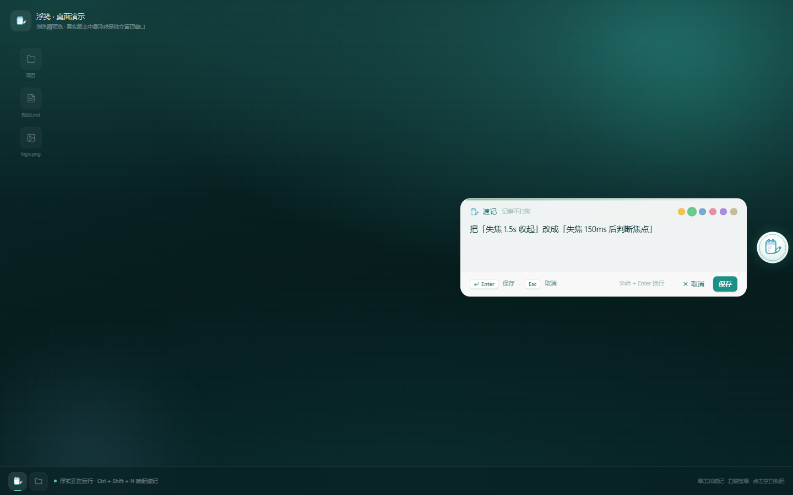
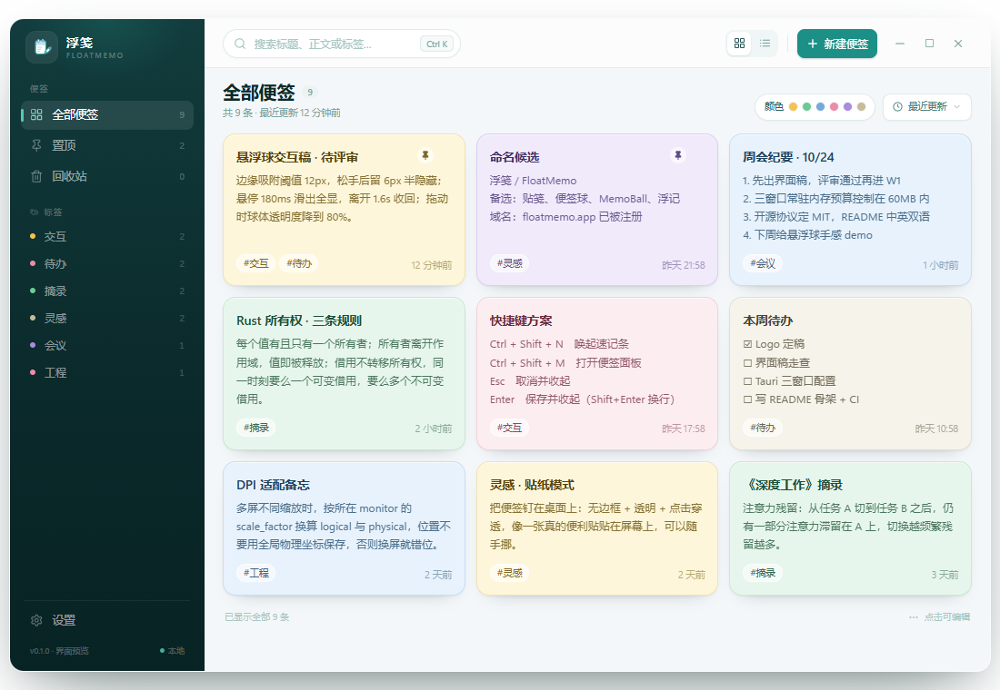
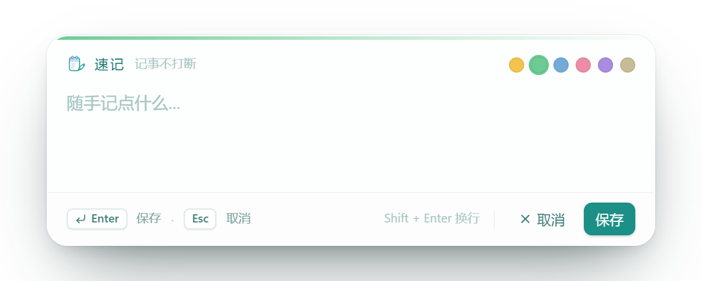
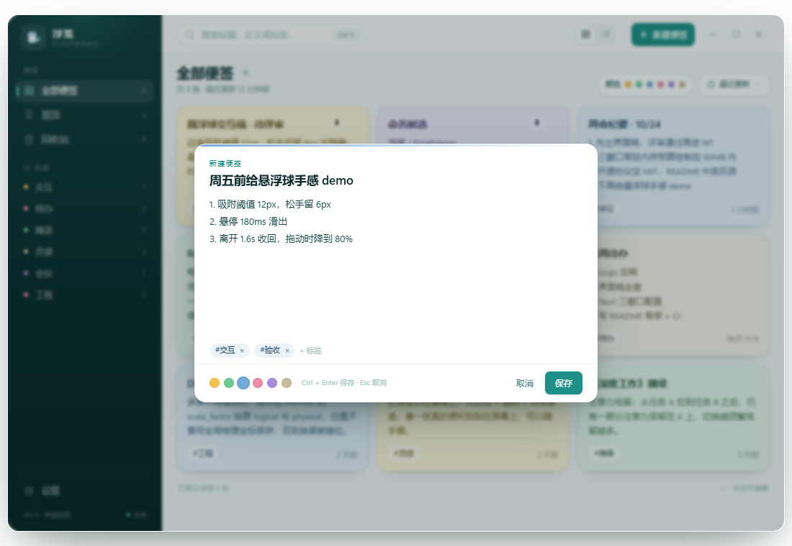
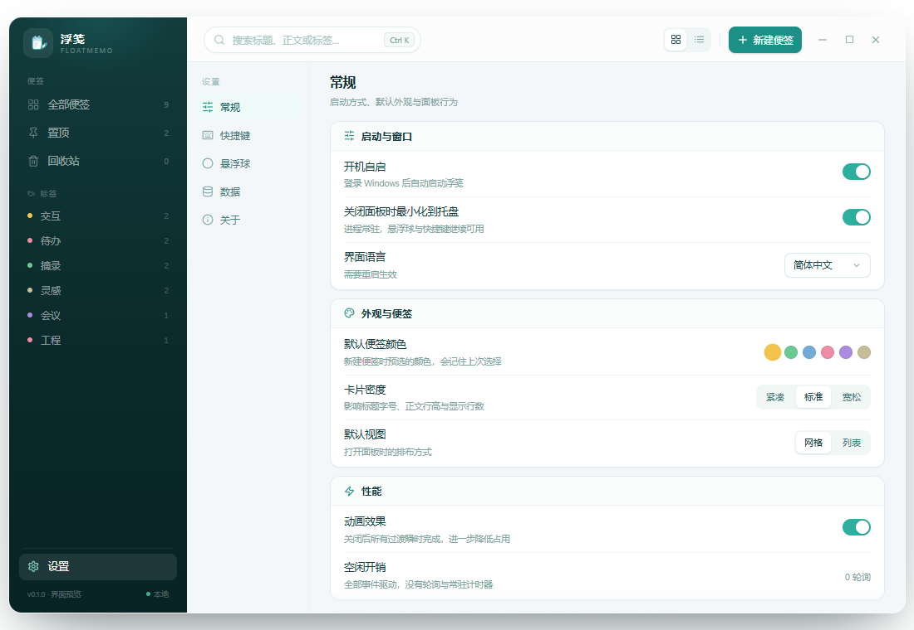

# FloatMemo（浮笺）｜一只贴在屏幕边上的小黄便签

> 为那些「灵光一现就该被看见」的时刻而生的 Windows 桌面便签。

---

## 一、它是什么

FloatMemo 是一款 **Windows 桌面悬浮便签**应用。它平时缩成一颗小球，贴在屏幕边缘；想记东西时点一下就展开，记完收回，不占地方、不打扰你。

一句话：**它不是笔记软件，是「把想法从脑子里倒出来」这件事本身。**

---

## 二、为什么需要它

你一定经历过这些：

- 写代码到一半，突然想到一个 bug 的解法，切到记事本记下，切回来——思路已经断了。
- 开会时别人说了一串数字，想记一下，手机掏出来、解锁、打开 App，太慢。
- 便签软件一打开就是一片空白的「新建笔记」，反而增加了心理负担。

FloatMemo 的答案是：**让便签一直待在屏幕上，伸手就能够到。**

---

## 三、它长什么样

### 悬浮球

一颗 74px 的小黄球，贴在屏幕右侧，半透明磨砂质感。它不是装饰——它是整个应用的入口。

- **单击** → 弹出 520×180 的速记条，打字即存
- **右键** → 菜单：新建便签 / 打开面板 / 开机自启 / 透明度 / 退出
- **拖动** → 可以在屏幕上随便挪，松手靠近边缘自动磁吸；也可以在设置里关掉磁吸，让它停在屏幕中间
- **静置 3 秒** → 自动缩到只露 6px 边缘（半隐藏），鼠标移过来再展开

> *悬浮球的图标——一颗便签与笔。桌面演示版里它就贴在屏幕右边缘，旁边是展开的速记条。*

> *「浮笺 · 桌面演示」设计稿：球贴右边缘，单击弹出速记条，左下角托盘常驻。*

### 便签面板

`Ctrl+Shift+M` 打开主面板。这里是你全部便签的家：

- 卡片式布局，每张便签可拖动、改色、置顶、归档
- 标签筛选、搜索、排序、回收站
- 支持 JSON / Markdown 导入导出，换设备不丢数据

> *面板设计稿（v0.1.0 界面预览）：左侧导航 + 九宫格卡片，支持按颜色/标签/排序筛选。*

### 速记条

`Ctrl+Shift+N` 唤出，或者单击悬浮球。写完回车就存，Esc 收回。**没有保存按钮，因为保存是自动的。**

> *速记条：顶栏颜色选择、底栏快捷键提示（Enter 保存 / Esc 取消 / Shift+Enter 换行）。*

### 新建便签

> *新建便签弹窗：标题、正文、标签（#交互 #验收）、颜色、Ctrl+Enter 保存。*

### 设置中心

> *设置页（v0.1.0 界面预览）：开机自启、默认便签颜色、卡片密度、默认视图、动画效果、空闲关销。*

---

## 四、它有什么特别的

### 1. 单窗口，四种形态

大多数 Tauri 桌面应用会为每个界面开一个 webview，但这台机器上第二个 webview 会停在 `about:blank`——窗口建出来了但内容不渲染，变成一块「透明玻璃」挡在屏幕前面。

FloatMemo 的解法是：**只有一个窗口，四种形态就地切换尺寸。**

| 形态 | 尺寸 | 触发 |
|------|------|------|
| ball | 74×74 | 默认 |
| quick | 520×180 | 单击球 / Ctrl+Shift+N |
| menu | 320×372 | 右键球 |
| panel | 1080×720 | Ctrl+Shift+M |

切换靠 Rust 发事件 + 前端改状态，丝滑无闪屏。

### 2. 真正的圆形窗口

用 `SetWindowRgn` + `CreateEllipticRgn` 把球窗裁成真正的圆形。方形的透明区不会绘制、也不会吃点击——顺带解决了贴边时透明余量挡鼠标的老问题。

### 3. 自己算拖动位移

Tauri 的 `startDragging()`（系统原生拖窗）在这台机器上不生效。于是改成：前端用 `screenX/Y` 算增量 → Rust 乘 DPI 缩放后 `set_position`。单击还是速记，移动超过 5px 才算拖动。

### 4. SQLite 落盘

数据不只在 localStorage。用 `tauri-plugin-sql` 存 SQLite，策略是「先 upsert 全部，再 `DELETE ... id NOT IN (...)` 清理远端已删行」——避免出现「表被清空」的窗口期。500ms 防抖，退出前强制 flush。

### 5. MySQL 备份（v0.2.0 新增）

如果你用的是云数据库（TiDB Cloud 等），可以直接把便签备份到远端：

- 设置里填主机 / 端口 / 用户 / 密码 / 数据库 / 表名
- 支持三种加密方式：明文、TLS 校验证书、TLS 不校验（自签名用）
- **TiDB Cloud 强制 TLS**：默认明文连接会被 `ERROR 1105 insecure transport are prohibited` 拒绝，选「TLS 校验」即可
- 点「备份到 MySQL」，进度和上次备份时间一目了然

### 6. 开机自启 + 全局快捷键

- 开机自启：设置页开关，真正写系统启动项，失败回滚并提示
- `Ctrl+Shift+N` 速记 / `Ctrl+Shift+M` 面板

---

## 五、技术栈

| 层 | 技术 |
|----|------|
| 桌面壳 | Tauri 2 |
| 前端 | React 19 + TypeScript + Vite 7 + Tailwind CSS 4 |
| 状态 | Zustand 5（persist） |
| 数据 | SQLite（tauri-plugin-sql） |
| 备份 | MySQL（`mysql` crate 25 + rustls-tls） |
| 打包 | GitHub Actions（windows-latest + Node 20 + Rust msvc + NSIS） |

---

## 六、获取与参与

- **Release**：https://github.com/djzrs/FloatMemo/releases
  - `FloatMemo_0.2.1_x64-setup.exe`（安装包）
  - `FloatMemo-portable.exe`（免安装，双击即用）
- **仓库**：https://github.com/djzrs/FloatMemo
- 开发节奏：功能分支 → 合并 master → 打 tag → CI 自动出包

---

## 七、写在最后

FloatMemo 是一个很个人的项目——它诞生于「我不想在记录想法这件事上浪费任何一秒」这个朴素的念头。

它不完美：贴左/上/下边时球窗有 136px 的 Windows 最小宽度限制，透明余量会伸进屏幕；拖动是自己算的，不是系统原生的；面板形态下不置顶，可能会被别的窗口盖住。

但它足够小、足够快、足够安静。小到你可以忽略它，快到你不用等它，安静到它不打扰你正在做的任何事。

**有时候，最好的工具就是没有工具。FloatMemo 努力成为那个「不存在，但一直在」的东西。**

---

*FloatMemo v0.2.1 · 一只贴在屏幕边上的小黄便签*

> **关于配图**：`docs/` 下的 PNG 是项目早期的 **Figma 界面预览设计稿**（面板/设置页左下角标注为 v0.1.0 界面预览），不是当前 0.2.1 版本的实机截图。布局与交互在 0.2.1 保持一致，仅配色与细节有迭代。实机效果请以 Release 里的安装包为准。